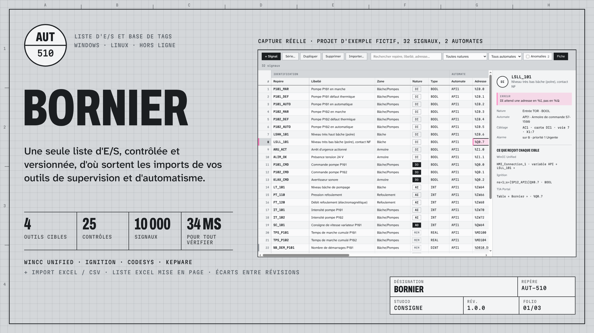

# Bornier : liste d'E/S et base de tags

Bornier tient la liste d'E/S d'un projet d'automatisme, la contrôle (25 contrôles), la versionne (révisions et rapport d'écarts) et en tire les fichiers d'import de **WinCC Unified** (TIA Portal), **Ignition** 8.1 / 8.3, **CODESYS** V3 (PLCopenXML) et **Kepware**, ainsi qu'une liste d'E/S Excel mise en page.

Application de bureau pour Windows 10/11 (64 bits) et Linux, hors ligne.

## Essai gratuit de 30 jours

Téléchargez la dernière version dans les [Releases](../../releases/latest) :

* `Bornier-Setup-1.0.0.exe` : installeur Windows, sans droits administrateur
* `Bornier-1.0.0-win-x64.zip` : version portable Windows
* `Bornier-1.0.0-x86_64.AppImage` : Linux
* `SHA256SUMS.txt` : sommes de contrôle

L'essai ouvre toutes les fonctions pendant 30 jours, sans compte ni carte. Ensuite, vos projets restent lisibles et modifiables ; seuls les exports demandent une licence annuelle (poste ou bureau de 10 postes), vendue sur [Gumroad](https://gumroad.com/l/bornier-liste-es).

L'installeur n'est pas encore signé : si Windows SmartScreen l'arrête, cliquez sur « Informations complémentaires » puis « Exécuter quand même ».

## Documentation

* [Guide d'utilisation](docs/guide.html) (aussi dans l'application : Aide › Guide d'utilisation)
* [Formats d'export et leur provenance](docs/FORMATS.md)
* [Exemples](docs/exemples/) : le projet d'exemple fictif `station-sp12.bornier` et tous les fichiers qu'il produit, pour juger les formats avant d'installer quoi que ce soit

## Licence et support

Logiciel propriétaire, voir [LICENSE](LICENSE). Ce dépôt ne contient que la documentation, les exemples et les versions publiées. Support : support@consignestudio.fr.

WinCC et TIA Portal sont des marques de Siemens AG, Ignition d'Inductive Automation, CODESYS de CODESYS GmbH, Kepware de PTC Inc. Bornier n'est affilié à aucun de ces éditeurs.
